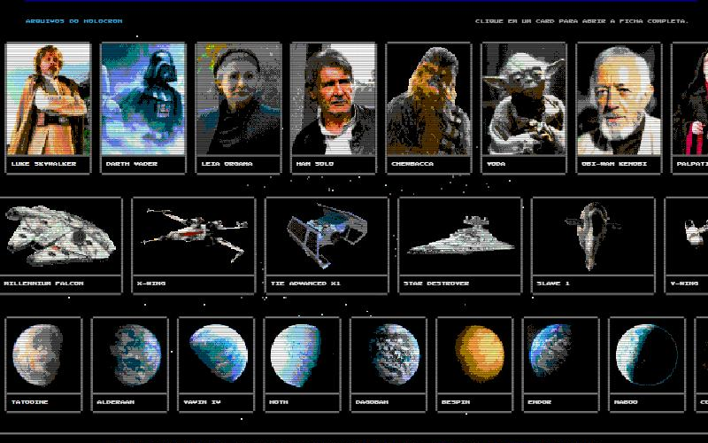
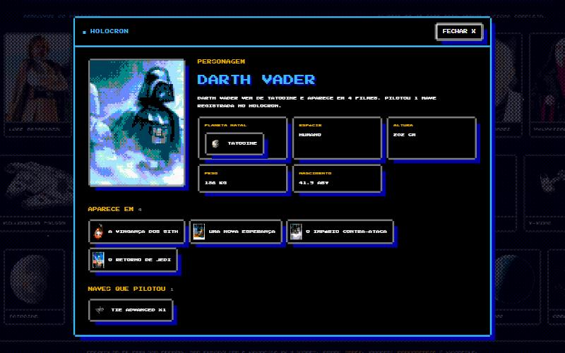

# Star Wars Quiz

**Jogue Agora: https://eduardolafaiety.github.io/StarWars-Quiz/**

Quiz De Fã Em HTML, CSS E JavaScript Puros, Com Visual De Jogo De 8 Bits. Escolha O Lado Da Luz Ou O Lado Sombrio, Jogue Sozinho Ou Em Duelo, E Responda 10 Perguntas Geradas A Partir Da [SWAPI](https://swapi.info).


## Telas

| Pergunta Com Comparação Em Escala Real | Resultado Com A Patente Da Partida |
| --- | --- |
|  |  |

**Modo Duelo**


| Galeria Do Holocron | Ficha Da Wiki |
| --- | --- |
|  |  |

| No Celular | Pergunta No Celular |
| --- | --- |
|  |  |

## O Que Tem No Jogo

- Escolha De Lado: A Cor Do Sabre Pinta A Interface, E Sua Nave Avança Rumo Ao Alvo A Cada Pergunta.
- 16 Tipos De Pergunta Sobre Personagens, Naves, Planetas E Filmes, Em 5 Modos De Jogo.
- Barras Em Escala Real Depois Das Perguntas De Comparação.
- 20 Segundos Por Pergunta, Multiplicador Por Sequência De Acertos E Recorde Salvo No Navegador.
- "Usar A Força" Corta 2 Alternativas, E "Saltar" Troca A Pergunta, Uma Vez Cada Por Partida.
- Visual De 8 Bits: Todo O Texto Em Letras Maiúsculas, Pequenas E Pixeladas (Press Start 2P), Caixas Com Cantos Recortados, Barras Em Blocos, Animações Em Passos E Sons Em Onda Quadrada.
- Fotos Reais De Personagens, Naves, Planetas E Pôsteres (Wookieepedia), Convertidas Na Hora Em Pixel Art Com A Paleta Do NES E Pontilhado, No Holoprojetor, Nas Alternativas, Na Galeria Do Holocron E Nas Telas De Abertura E Resultado. Quando A Foto Entregaria A Resposta, O Holoprojetor Mostra Os Candidatos Lado A Lado.
- Holocron: Na Tela Inicial, Cada Card De Personagem, Nave Ou Planeta Abre Uma Ficha No Estilo Wiki, Com Planeta Natal, Espécie, Medidas, Filmes, Naves Pilotadas, Pilotos, Nativos E Mais. Tudo Na Ficha É Link Para Outra Ficha, E O Botão Voltar Refaz O Caminho.
- Salto Para O Hiperespaço, Sons Sintetizados E Atalhos De 1 A 4 No Teclado.
- Patente Final De Youngling A Mestre Jedi, Ou De Acólito A Lorde Sombrio.
- Modo Duelo Para Dois Jogadores No Mesmo Aparelho: Os Dois Respondem A Mesma Pergunta, Cada Um No Seu Painel (Teclas 1 A 4 E 7 A 0, Ou Toque Na Tela). Cada Acerto Tira 25 De Vida Do Outro, E Quem Acerta Mais Rápido Tira 35. Vence Quem Zerar O Adversário Ou Terminar As 15 Rodadas Com Mais Vida.

## Rodar Localmente

```bash
npx http-server . -p 4173
```

## Publicar No GitHub Pages

O Projeto Não Tem Etapa De Build. O Site É Publicado A Partir Da Branch `main`, Na Pasta `/ (root)`, E Cada Push Atualiza O Site Em Alguns Minutos.

## Como Funciona

- `js/quiz.js`: Gera As Perguntas E Calcula Pontos E Patentes. Não Depende Do Navegador.
- `js/app.js`: Telas, Cronômetro, Sons, Estrelas E Carregamento Da API.
- `js/art.js`: Fotos Reais E As Ilustrações Em SVG Que Entram No Lugar Se Uma Foto Não Carregar.
- `js/wiki.js`: Monta As Fichas Do Holocron A Partir Dos Dados Da SWAPI, Com Os Termos Mais Comuns Traduzidos.
- `js/pixel.js`: Transforma As Fotos Em Pixel Art (Grade Grossa, Paleta Do NES E Pontilhado De Bayer) E Desenha Os Sprites, O Cursor E Os Sabres Cruzados.
- `data/galaxy.js`: Cópia Local Da SWAPI, Usada Se A API Ao Vivo Não Responder.
- `data/images.js`: Links Das Fotos Na Wookieepedia. As Imagens Não Ficam No Repositório, São Carregadas Direto De Lá.

## Scripts

Atualizar A Cópia Local Dos Dados:

```bash
node scripts/sync-swapi.mjs
```

Atualizar Os Links Das Fotos:

```bash
node scripts/sync-images.mjs
```

Redesenhar O Ícone Do Site (Millennium Falcon Em Pixel Art, Sem Fundo):

```bash
node scripts/make-icon.cjs
```

Gerar 7.500 Partidas E Conferir As Regras Das Perguntas:

```bash
node scripts/check-quiz.cjs
```

Projeto De Fã, Sem Vínculo Com A Lucasfilm Ou A Disney.
