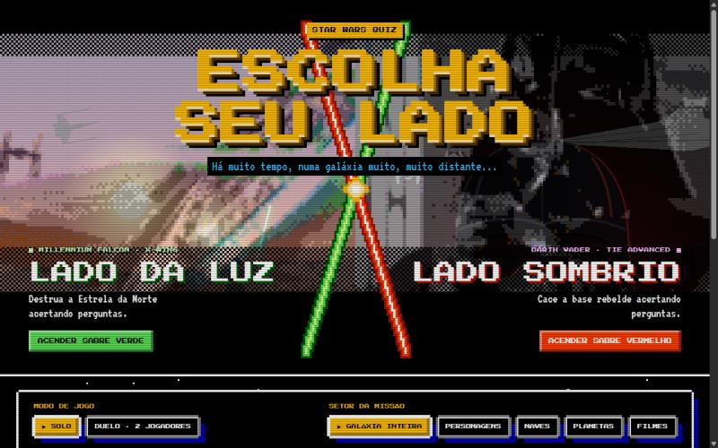
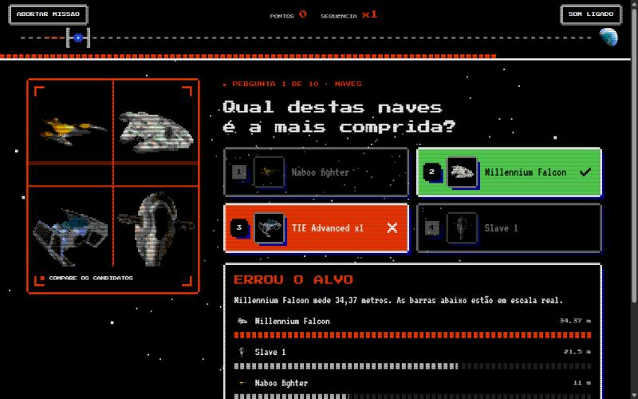
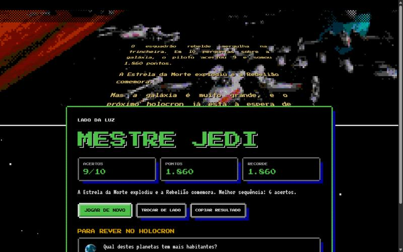
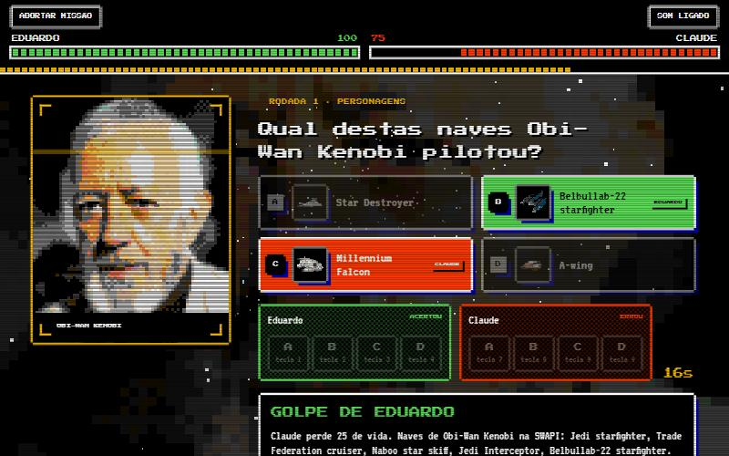
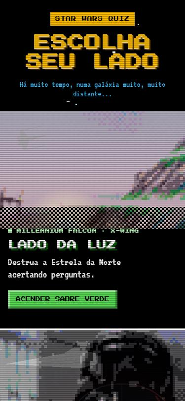
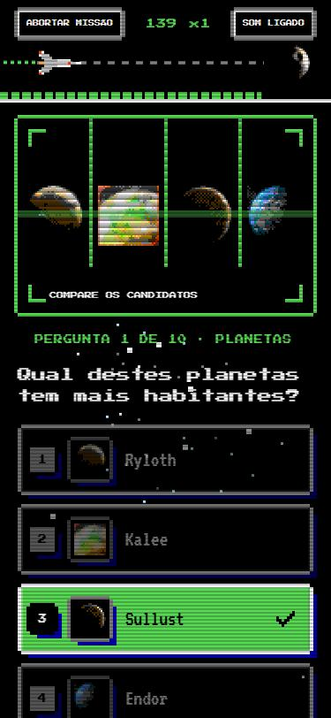

# Star Wars Quiz

**Jogue agora: https://eduardolafaiety.github.io/StarWars-Quiz/**

Quiz de fã em HTML, CSS e JavaScript puros, com visual de jogo de 8 bits. Escolha o Lado da Luz ou o Lado Sombrio, jogue sozinho ou em duelo, e responda 10 perguntas geradas a partir da [SWAPI](https://swapi.info).



## Telas

| Pergunta com comparação em escala real | Resultado com a patente da partida |
| --- | --- |
|  |  |

**Modo Duelo**



| No celular | Pergunta no celular |
| --- | --- |
|  |  |

## O que tem no jogo

- Escolha de lado: a cor do sabre pinta a interface, e sua nave avança rumo ao alvo a cada pergunta.
- 16 tipos de pergunta sobre personagens, naves, planetas e filmes, em 5 modos de jogo.
- Barras em escala real depois das perguntas de comparação.
- 20 segundos por pergunta, multiplicador por sequência de acertos e recorde salvo no navegador.
- "Usar a Força" corta 2 alternativas, e "Saltar" troca a pergunta, uma vez cada por partida.
- Visual de 8 bits: fontes pixeladas, caixas com cantos recortados, barras em blocos, animações em passos e sons em onda quadrada.
- Fotos reais de personagens, naves, planetas e pôsteres (Wookieepedia), convertidas na hora em pixel art com a paleta do NES e pontilhado, no holoprojetor, nas alternativas, na galeria do holocron e nas telas de abertura e resultado. Quando a foto entregaria a resposta, o holoprojetor mostra os candidatos lado a lado.
- Salto para o hiperespaço, sons sintetizados e atalhos de 1 a 4 no teclado.
- Patente final de Youngling a Mestre Jedi, ou de Acólito a Lorde Sombrio.
- Modo Duelo para dois jogadores no mesmo aparelho: os dois respondem a mesma pergunta, cada um no seu painel (teclas 1 a 4 e 7 a 0, ou toque na tela). Cada acerto tira 25 de vida do outro, e quem acerta mais rápido tira 35. Vence quem zerar o adversário ou terminar as 15 rodadas com mais vida.

## Rodar localmente

```bash
npx http-server . -p 4173
```

## Publicar no GitHub Pages

O projeto não tem etapa de build. O site é publicado a partir da branch `main`, na pasta `/ (root)`, e cada push atualiza o site em alguns minutos.

## Como funciona

- `js/quiz.js`: gera as perguntas e calcula pontos e patentes. Não depende do navegador.
- `js/app.js`: telas, cronômetro, sons, estrelas e carregamento da API.
- `js/art.js`: fotos reais e as ilustrações em SVG que entram no lugar se uma foto não carregar.
- `js/pixel.js`: transforma as fotos em pixel art (grade grossa, paleta do NES e pontilhado de Bayer) e desenha os sprites, o cursor e os sabres cruzados.
- `data/galaxy.js`: cópia local da SWAPI, usada se a API ao vivo não responder.
- `data/images.js`: links das fotos na Wookieepedia. As imagens não ficam no repositório, são carregadas direto de lá.

## Scripts

Atualizar a cópia local dos dados:

```bash
node scripts/sync-swapi.mjs
```

Atualizar os links das fotos:

```bash
node scripts/sync-images.mjs
```

Gerar 7.500 partidas e conferir as regras das perguntas:

```bash
node scripts/check-quiz.cjs
```

Projeto de fã, sem vínculo com a Lucasfilm ou a Disney.
